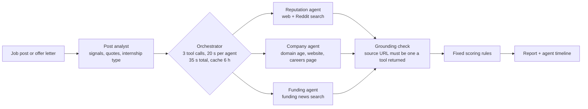

# NibbleContract AI

> Check the internship before you apply, and the offer before you sign.

Fake internships are everywhere: "training programs" that charge a fee, WhatsApp-only onboarding, stipends that are too good to be true, offer letters from companies that don't exist. NibbleContract AI gives students a **0 to 100 trust score** for an internship, with the evidence behind every point, so they can decide before they pay, apply or sign.

**Live demo:** https://nibblecontractai.in (free hosting, so the first load can take a few seconds)

## Two checks

| | **Check a job post** | **Check an offer letter** |
|---|---|---|
| When | Before you apply | After you're selected |
| Input | Paste the post, or a link to it | Paste the letter, or upload a PDF / .txt |
| Optional | Company name, website | Sender email, company name, website |
| You get | Trust score, risk level, **internship type**, warning and good signs with evidence, research agent timeline, questions to ask before applying, a "verify it yourself" checklist | The same trust score and research, plus red flags in the terms (bonds, deposits, held certificates) with the exact clause quoted, money and deadlines, and questions to ask before signing |

The report shows a risk level (**Low**, **Medium** or **High risk**, e.g. "High risk: 3 warning signs found") and the evidence. It never calls a company a scam: it's an estimate from public information, not a judgement.

**Internship type** (job posts): `paid_internship`, `unpaid_internship`, `training_or_paid_course` (a course or certificate sold as an internship), `agency_or_recruiter_post` or `unclear`. The label is only used when the lines that justify it are really in the post.

## How the score works

AI models only **find evidence**. Fixed Python rules in [`job_signals.py`](job_signals.py) (job posts) and [`authenticity.py`](authenticity.py) (offer letters) turn that evidence into the number, so the score is explainable and a model can't talk itself into a flattering result.

**Rules for job posts** (offer letters follow the same idea in `authenticity.py`, with good signs capped at +25 and a maximum of 85): start at 50. Each counted warning subtracts **20 / 10 / 5** (high / medium / low); good signs add, capped at +40. Then:

- A confirmed **payment request caps the score at 25**, whatever the good signs.
- Any other confirmed high-severity warning caps it at 35.
- The score never goes above **85 from the text alone**, or **90 when online research found real evidence**: a post can't prove a company exists.
- **No reviews and no funding is neutral**, never negative. Many genuine startups have neither.
- **Funding is a bonus only**; it never cancels a fee request.
- Warnings that scammers are *using* a company's name are shown but never held against the company.

Score 70+ is Low risk, 40 to 69 Medium, under 40 High.

| Weight | Warning signs (job posts) |
|---|---|
| **High** | Asks for any payment (fee, deposit, "refundable" amount, paid certificate or LOR, laptop or kit) · training or course first, internship later (or classified as a paid course) · onboarding only through WhatsApp/Telegram groups or mass calls · stipend unrealistic for the work · credible reports that the company itself took fees or never paid · domain under 90 days old, or the domain/website doesn't exist |
| **Medium** | Training provider advertising an "internship" · guaranteed placement · "limited seats, apply in 24 hours" urgency · vague role · free email (Gmail etc.) or shortened links · website doesn't mention the company · complaints online (unpaid stipend, ghosting) · domain under a year old |
| **Low** | No named contact or recruiter · sloppy or copy-paste writing |

| Weight | Good signs |
|---|---|
| **Medium** | Clear stipend with duration and hours · specific tasks, tools and team · a real selection process (assignment, technical interview) · "no fees at any stage" · the company's careers page lists the role · recent funding news from an established news site · positive first-hand experiences online |
| **Low** | Older funding news · domain registered 2+ years |

Everything is in one module, [`job_signals.py`](job_signals.py), so the weights and caps are easy to tune.

## Research agents

The online research is done by three [Agno](https://docs.agno.com) agents running **in parallel**, after a post analyst reads the text. Total time is about the slowest agent (typically 15 to 20 seconds per check), not the sum.



| Agent | What it checks | Tools |
|---|---|---|
| Post analyst | Warning and good signs with verbatim quotes, internship type | Groq LLM, quote verification |
| Reputation agent | Fraud claims, complaints, real experiences, fake-offer warnings | Tavily search (general and Reddit), DuckDuckGo as fallback |
| Company agent | Does the company look real: domain age, website, careers page | Custom tools wrapping `lookups.py` (RDAP, SSRF-safe fetch, trafilatura) |
| Funding agent | Has the company raised money, when, how much | Tavily news search, DuckDuckGo as fallback (search only, no scraping) |

- Each agent returns a fixed Pydantic schema (`findings: [{claim, stance, source_url, snippet, date}]`) through Agno's structured output. Status, timing and tool calls are recorded by the orchestrator and shown in the report as a timeline.
- If an agent fails or times out, the plain non-agent check runs instead and the agent is marked "unavailable". A report never fails because of an agent. `AGENTS_ENABLED=0` turns the agents off entirely.
- Search queries are built by the tools, not the model: always `"<company>" + a few plain keywords`. The post or letter itself is never sent to a search API.

### The grounding rule

- Every quote must exist in the user's text, or it is shown as unverified and **not counted**.
- Every web finding must point to a URL that a tool actually returned in that run. The tools record every result; anything else is dropped and marked unverified.
- The evidence shown is always the real search snippet, never model-written text.
- Fetched pages and search results are treated as untrusted data: the models are told never to follow instructions inside them.

In testing this caught real hallucinations: for a made-up company, the funding agent "found" a seed round and a Series A with links no tool had returned. Neither counted.

## Login

The tool at `/app` is for logged-in users; the landing page stays public. Accounts are handled by [Supabase Auth](https://supabase.com/docs/guides/auth) with email and password: create an account, log in, log out, and reset a forgotten password from `/login`.

- The browser logs in with `supabase-js`. Every check sends the user's access token, and the server ([`auth.py`](auth.py)) confirms it with Supabase before spending any Groq or Tavily credits. Requests without a valid login get `401`.
- Only the Supabase URL and the publishable key reach the browser; both are public by design. Confirmed logins are cached for 5 minutes, keyed by a hash of the token.
- Without `SUPABASE_URL` and `SUPABASE_PUBLISHABLE_KEY` the app runs open, which is handy for local development.

Supabase's built-in email service only delivers to your own Supabase team (2 emails an hour). For public sign-ups, either turn off **Confirm email** (Authentication → Sign In / Providers → Email) or add your own SMTP provider.

## Free APIs

| Service | Used for | Key |
|---|---|---|
| [Supabase](https://supabase.com) (free plan) | Accounts and login | `SUPABASE_URL`, `SUPABASE_PUBLISHABLE_KEY` |
| [Groq](https://console.groq.com) (free tier) | Post analyst, agents, offer review | `GROQ_API_KEY` (required) |
| [Tavily](https://tavily.com) (1,000 free credits/month) | Web, Reddit and funding search, about 3 credits per check (at most 6), cached 6 hours | `TAVILY_API_KEY` (optional) |
| DuckDuckGo (via `ddgs`) | Search fallback when Tavily is missing, fails or runs out | none |
| RDAP | Domain registration dates | none |

No paid services, and no scraping of LinkedIn, Naukri, Crunchbase or other sites whose terms forbid it. Links to LinkedIn, Naukri and similar job boards get a friendly "paste the text instead" message.

Groq's free tier limits tokens per minute per model, so the agents are spread across models (`GROQ_AGENT_MODELS`). Running many checks within the same minute can still mark an agent "unavailable"; the fallback keeps the report complete.

## Run it

```bash
python -m venv venv
.\venv\Scripts\Activate.ps1          # macOS/Linux: source venv/bin/activate
pip install -r requirements.txt
copy .env.example .env               # macOS/Linux: cp; then add your Groq key
python app.py
```

Open http://127.0.0.1:5001 for the landing page, or http://127.0.0.1:5001/app for the tool. The fictional examples open directly: `/app?example=post_risky`, `/app?example=post_genuine`, `/app?example=offer_fake`.

| Setting (`.env`) | Default | What it does |
|---|---|---|
| `GROQ_API_KEY` | | Required |
| `GROQ_MODEL` | `openai/gpt-oss-120b` | Post analyst and offer review |
| `TAVILY_API_KEY` | | Optional web search |
| `AGENTS_ENABLED` | `1` | `0` uses the plain, non-agent checks |
| `GROQ_AGENT_MODELS` | `openai/gpt-oss-20b,openai/gpt-oss-120b,openai/gpt-oss-20b` | One model per agent: reputation, company, funding |
| `GROQ_PARSER_MODEL` | `openai/gpt-oss-120b` | Turns each agent's answer into the Pydantic schema |
| `LIVE_LOOKUPS` | `1` | `0` turns off every online check |
| `SUPABASE_URL` | | Your Supabase project URL; with the key below, turns login on |
| `SUPABASE_PUBLISHABLE_KEY` | | The project's publishable key (`sb_publishable_...`) |

### Tests

```bash
pip install -r requirements-dev.txt
python -m pytest
```

The tests use fake models and tools, so they never touch the network. They cover the scoring rules (fee requests cap at 25, funding is a bonus only, no reviews is neutral), evidence grounding (invented URLs are dropped), internship-type handling, orchestrator timeouts and fallbacks, and the LinkedIn/Naukri message.

## API

Both check endpoints need `Authorization: Bearer <Supabase access token>` when login is on.

- `POST /check-post`: form fields `text` or `url`, plus optional `company_name`, `website`. Returns `score`, `risk_level`, `risk_label`, `confidence`, `internship_type`, `signals`, `checks`, `agents` (the timeline), `questions`, `checklist`, `limits`.
- `POST /decode`: an offer letter as `text` or `file` (PDF/.txt, up to 5 MB), plus optional `sender_email`, `company_name`, `website`. Returns the term review with an `authenticity` block (score, risk level, signals, agents).
- `GET /status`: health check.

## Privacy

Posts and letters are processed in memory only, never written to disk or logged (the logs hold only sizes and outcomes). Only the company name and domain are sent to search and lookup services. Saved reports live in the user's own browser and contain the report, not the document.

## Limits

This is an estimate from the text and public information. It cannot confirm that a company or recruiter is real, and the AI parts can vary between runs (only grounded evidence counts toward the score). Always verify through the company's official website. **Not legal advice.**

## Project structure

```text
decoder/
├── app.py              # Flask routes, brand name and tagline
├── auth.py             # login check for the API (Supabase Auth)
├── job_post.py         # job-post check: link reading, post analyst, internship type
├── job_signals.py      # job-post signal catalogue and scoring rules
├── decoder.py          # offer-letter review: extraction, prompts, JSON repair, quote verification
├── authenticity.py     # offer-letter trust score, sender and domain checks
├── lookups.py          # RDAP domain age and SSRF-safe website checks
├── reviews.py          # non-agent web and Reddit search (fallback)
├── agents/
│   ├── orchestrator.py # parallel runs, timeouts, cache, fallbacks, grounding
│   ├── specialists.py  # the three agents and findings-to-signals rules
│   ├── tools.py        # Agno toolkits and the recorder that grounds them
│   └── schemas.py      # Pydantic output schema
├── templates/          # landing page and tool
├── static/             # styles, scripts, fictional examples
└── tests/              # pytest suite (no network)
```

## Later

The design leaves room for:

- A Chrome extension that checks the job post you're viewing (which also solves LinkedIn and Naukri blocking automated reading).
- A Telegram or WhatsApp bot where students forward a suspicious offer.
- An optional read-only Gmail check of the offer email's sender headers.
